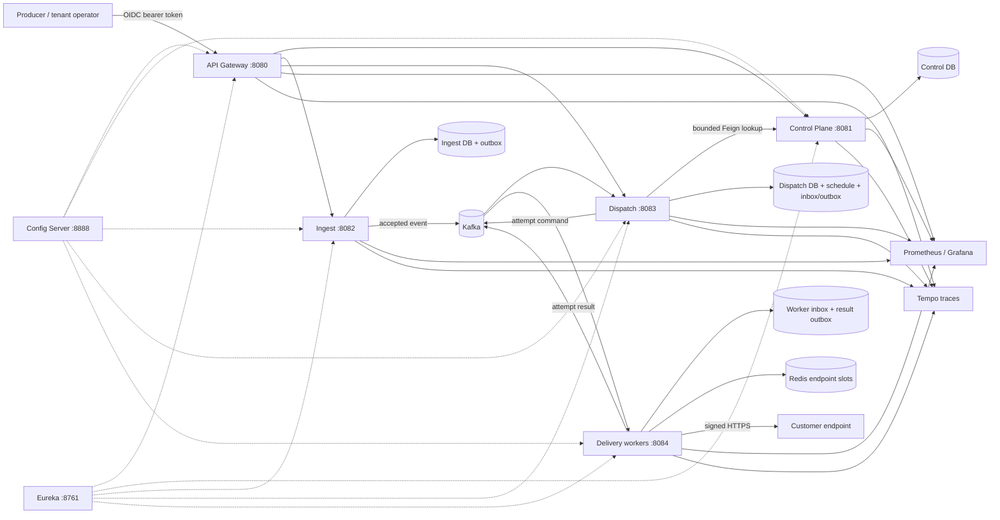
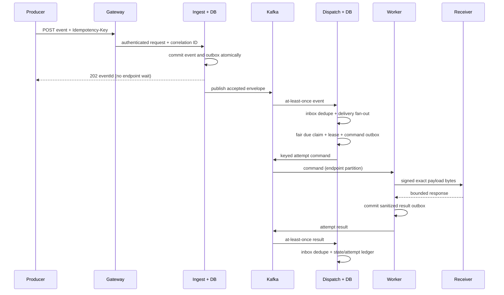

# RelayForge

RelayForge is a production-minded, multi-tenant webhook delivery platform built with Java and Spring Cloud. It accepts an event once, durably fans it out to matching subscriptions, and performs signed HTTPS delivery with bounded retries, dead-lettering, replay, tenant fairness, endpoint concurrency, and an inspectable attempt ledger.

It is for platform teams that have outgrown “put an HTTP call in a background job.” RelayForge is deliberately honest about the hard boundary: delivery is **at least once**, never exactly once. A receiver must verify signatures and atomically deduplicate `Webhook-Id` before applying side effects.

## What is implemented

- OAuth2/OIDC entry through one Spring Cloud Gateway, with Keycloak seed data, role/scope enforcement, correlation IDs, request caps, RFC 9457-style failures, and Redis tenant rate limits.
- Tenant-scoped endpoint registration, subscription event types, top-level exact-match payload filters, configurable delivery policy, encrypted one-time signing secrets, bounded current/previous-key rotation, and append-only audit rows.
- Durable producer acceptance with tenant-scoped idempotency fingerprints and a PostgreSQL transactional outbox.
- Spring Cloud Stream/Kafka event, command, and result channels; inbox uniqueness prevents a redelivery from creating a second logical delivery or applying one result twice.
- PostgreSQL scheduling with explicit states, `FOR UPDATE SKIP LOCKED`, bounded per-tenant batches, endpoint/tenant in-flight limits, short leases, recovery, retry with full jitter, bounded `Retry-After`, dead-letter, cancellation, and same-delivery replay generations.
- Horizontally scalable workers with Redis endpoint slots, bounded endpoint-group circuit breakers, exact-byte HMAC-SHA256 signing, strict redirect/response/timeout handling, and a durable result outbox.
- A deterministic signature-verifying sink supporting success, 429, 500, timeout, delayed success, flaky, and duplicate-sensitive modes.
- Actuator, Prometheus metrics, OpenTelemetry/Micrometer tracing to Tempo, structured ECS JSON logs, a provisioned Grafana dashboard, and Prometheus alert examples.
- Flyway migrations, unit tests, real-PostgreSQL Testcontainers tests, Maven Wrapper, Docker Compose, generated local credentials, repeatable demos, CI, runbooks, ADRs, and an API collection.

No browser dashboard is implemented; the backend acceptance path, API collection, sink timeline, Grafana, and Tempo are the operator surfaces.

## Architecture



### Durable acceptance and delivery



### Retry, dead-letter, and replay

```mermaid
stateDiagram-v2
    [*] --> SCHEDULED
    SCHEDULED --> IN_FLIGHT: fair claim + lease
    IN_FLIGHT --> SUCCEEDED: 2xx
    IN_FLIGHT --> DEAD_LETTERED: permanent 4xx / blocked target
    IN_FLIGHT --> RETRY_WAIT: 429 / timeout / connection / 5xx
    IN_FLIGHT --> RETRY_WAIT: expired worker lease
    RETRY_WAIT --> IN_FLIGHT: next_attempt_at due
    IN_FLIGHT --> DEAD_LETTERED: attempts exhausted
    DEAD_LETTERED --> SCHEDULED: authorized replay; generation + 1
    SCHEDULED --> CANCELLED: authorized cancellation
    RETRY_WAIT --> CANCELLED: authorized cancellation
```



### Data ownership

| Owner | Durable data | Other services may |
|---|---|---|
| Control plane | Tenants, endpoints, subscriptions, encrypted keys, policies, audit | Query a narrow internal subscription snapshot API |
| Ingest | Accepted events, idempotency keys/hashes, acceptance outbox | Consume only the versioned accepted-event message |
| Dispatch | Delivery snapshots, schedule, leases, attempts, event/result inboxes, command outbox, replay/cancel audit | Consume commands/results; query tenant-scoped public views |
| Worker | Command lease/dedupe and result outbox | Never mutate the dispatch ledger |
| Redis | Rate-limit tokens and short endpoint slots | Never serve as the only durable event or delivery record |

## Platform versions

| Component | Pinned version | Basis |
|---|---:|---|
| Java | 25 LTS | Oracle lists Java 25 as an LTS release in its [Java SE support roadmap](https://www.oracle.com/java/technologies/java-se-support-roadmap.html). |
| Spring Boot | 4.1.0 | Current stable release shown by the official [Spring Boot project](https://spring.io/projects/spring-boot/). |
| Spring Cloud | 2025.1.2 (Oakwood) | The official [Spring Cloud compatibility table](https://spring.io/projects/spring-cloud/) maps 2025.1.x to Boot 4.0.x and, from 2025.1.2, 4.1.x. |
| Maven Wrapper | 3.3.4 / Maven 3.9.11 | Repository-pinned build launcher and distribution. |
| Testcontainers | 2.0.5 | Real PostgreSQL integration tests; disabled only when Docker is unavailable. |

Infrastructure image tags are pinned in `docker-compose.yml` rather than floating on `latest`.

## Five-minute local start

Prerequisites: Docker with Compose v2, `curl`, `python3`, and `openssl`. Building outside Docker additionally requires Java 25; no system Maven is needed.

```bash
make up
make demo
```

`make up` creates a mode-600, Git-ignored `.env`, builds the applications, starts the dependencies with health checks, and seeds Keycloak. It is restart-safe: generated credentials are preserved and realm seeding is idempotent.

Useful local surfaces:

- Gateway: `http://localhost:8080`
- Control/ingest/dispatch OpenAPI: `http://localhost:8081/swagger-ui.html`, `:8082/swagger-ui.html`, `:8083/swagger-ui.html`
- Eureka: `http://localhost:8761`
- Keycloak: `http://localhost:8180`
- Grafana: `http://localhost:3000`
- Prometheus: `http://localhost:9090`
- Tempo API: `http://localhost:3200`

Seeded identities are `acme-admin`, `acme-operator`, and `globex-admin`; their generated passwords and the Grafana credential are in `.env`. Machine clients are `acme-producer` and `globex-producer`. These credentials are local-only and never committed.

```bash
make demo-success       # one signed 2xx delivery
make demo-retry         # two deterministic 500s, then success
make demo-rate-limit    # 429 + Retry-After, then success
make demo-dead-letter   # bounded 500s to terminal state
make demo-replay        # repair receiver and replay same delivery/event
make demo-rotation      # rotate key and deliver with overlap configured
make load-test          # COUNT=500 CONCURRENCY=16 by default
make down
```

The full `make demo` publishes one event to three endpoints: one succeeds, one succeeds after two retries, and one dead-letters. It then makes the failed receiver healthy and replays the same delivery. The script prints the actual API timeline; it never infers success from elapsed time alone.

## Webhook protocol

RelayForge sends:

| Header | Meaning |
|---|---|
| `Webhook-Id` | Stable logical event UUID; receiver dedupe key |
| `Webhook-Delivery-Id` | RelayForge delivery UUID |
| `Webhook-Timestamp` | Unix seconds used in the signature |
| `Webhook-Attempt` | 1-based attempt within the replay generation |
| `Webhook-Event-Type` | Versioned producer event type |
| `Webhook-Signature` | `v1=<base64 HMAC-SHA256>` |
| `X-Correlation-Id` | Safe cross-boundary diagnostic identifier |
| `traceparent` | Original trace context when supplied |

Signed bytes are `ASCII(Webhook-Id) + "." + ASCII(Webhook-Timestamp) + "." + exact_request_body`. Verify against the raw body before JSON parsing, use a constant-time comparison, reject timestamps outside tolerance, and atomically store `Webhook-Id` before side effects.

Java verification:

```java
byte[] prefix = (webhookId + "." + webhookTimestamp + ".")
    .getBytes(StandardCharsets.US_ASCII);
Mac mac = Mac.getInstance("HmacSHA256");
mac.init(new SecretKeySpec(secret.getBytes(StandardCharsets.UTF_8), "HmacSHA256"));
mac.update(prefix);
byte[] expected = mac.doFinal(rawRequestBody);
byte[] supplied = Base64.getDecoder().decode(signature.substring("v1=".length()));
boolean valid = MessageDigest.isEqual(expected, supplied);
```

JavaScript (Node.js) verification:

```javascript
import { createHmac, timingSafeEqual } from "node:crypto";

const prefix = Buffer.from(`${webhookId}.${webhookTimestamp}.`, "ascii");
const expected = createHmac("sha256", secret)
  .update(prefix)
  .update(rawRequestBody)
  .digest();
const supplied = Buffer.from(signature.slice("v1=".length), "base64");
const valid = supplied.length === expected.length && timingSafeEqual(expected, supplied);
```

The demo sink checks both the current key and the previous key only until `previousValidUntil`; the sender always uses the current key.

## Delivery semantics

### Guarantees

- A `202` is returned only after the event, idempotency fingerprint, and outbox row commit.
- The same tenant and idempotency key with identical metadata/body returns the original event ID; different content returns `409`.
- Kafka redelivery cannot create a second `(event, subscription)` logical delivery and duplicate results cannot increment attempts twice.
- Scheduling and retry time are durable in PostgreSQL. Restarting dispatch loses no in-memory timer because no timer is authoritative.
- A worker crash is recovered after its lease. If the HTTP outcome was ambiguous, RelayForge records `LEASE_EXPIRED` and retries; this can duplicate a receiver side effect.
- Replay increments an execution generation on the same event and delivery. Earlier attempts remain in the timeline.
- Permanent 4xx (including rejected redirects) and SSRF blocks dead-letter immediately. 408, 425, 429, timeout, connection failure, oversized response, and 5xx are bounded retries.

### Non-guarantees

- Exactly-once webhook effects are impossible without a transaction shared with the receiver, which RelayForge does not and should not have.
- Global event ordering is not provided. Kafka commands are keyed by endpoint; an endpoint requesting ordering has concurrency one. Duplicates remain possible after ambiguous failure.
- A `202` does not promise eventual success; it promises durable acceptance and policy-governed attempts.
- Customer response bodies are not retained. Operators see status, latency, byte count, sanitized outcome, and terminal reason.

### Failure matrix

| Boundary/outcome | RelayForge behavior | What may duplicate or be lost |
|---|---|---|
| Request fails before ingest commit | No `202`; producer retries same key | No accepted event is claimed |
| Commit succeeds, response is lost | Producer retries and gets original event ID | No extra logical event |
| DB commit succeeds, Kafka publish fails | Outbox remains unpublished and is retried | Kafka message may later duplicate |
| Kafka redelivers accepted event | Dispatch inbox ignores repeated domain effect | No extra logical delivery |
| Control lookup unavailable | Feign circuit fails truthfully; Kafka message is retried/DLQ'd by binder policy | Fan-out is delayed, not silently empty |
| Worker crashes before HTTP | Lease expires and attempt is retried | Usually no receiver effect |
| Worker crashes after receiver commits | Lease expires and attempt is retried | Receiver may see a duplicate |
| 2xx | `SUCCEEDED` | Ambiguous network loss can still retry before result is known |
| 429 | Honor valid future `Retry-After`, capped by policy; otherwise full jitter | At-least-once |
| 408/425/5xx/timeout/connect | Full-jitter exponential retry, bounded attempts/duration | At-least-once |
| Other 4xx or redirect | `DEAD_LETTERED` with reason | No automatic retry |
| Result Kafka duplicate | Result inbox ignores repeated state effect | Attempt counter remains correct |
| Kafka poison message | One application attempt, then named Kafka DLQ | Operator intervention required |

### Retry policy

For completed attempt `n`, the jitter ceiling is `min(maxDelay, initialDelay × 2^(n-1))`; RelayForge selects uniformly from zero through that ceiling. A valid future `Retry-After` can move the attempt later but never beyond `maxRetryAfter`. Default policy is 6 attempts, 2 seconds initial, 15 minutes maximum. One layer owns each retry: dispatch owns delivery retries; binder application retries are disabled and poison records go to DLQ.

### Fairness and backpressure

The due query ranks rows inside each tenant, admits at most `per-tenant-batch`, and interleaves rank before time. A tenant and endpoint must also remain below their in-flight cap. Redis slots close the distributed race between workers. Dispatch pauses new claims if its unpublished command outbox reaches a safe threshold; Kafka binder health/lag, DB pool health, oldest due age, saturation, and circuit state are exposed for alerting and autoscaling decisions. These controls prevent one large tenant from taking every claim batch; they do not reserve dedicated capacity or provide billing-grade weighted quotas.

## Security and tenancy

- Tenant identity comes only from the verified JWT `tenant_id` claim. Caller-provided tenant headers are removed at the gateway; tenant paths/bodies never establish identity.
- Human roles are `TENANT_ADMIN`, `TENANT_OPERATOR`, and `PLATFORM_ADMIN`; producers use OAuth2 client credentials with `events:write` and support the `PRODUCER` realm role.
- Every endpoint, event, delivery, rotation, replay, cancellation, and query adds tenant criteria at the persistence boundary. Testcontainers negative tests exercise cross-tenant read/rotate behavior.
- Secrets are 256-bit random values, returned only on creation/rotation, encrypted with AES-256-GCM and endpoint-bound AAD, and absent from logs/API list responses. The local master key is generated into `.env`; production must replace the provider with KMS/Vault envelope encryption.
- Target validation rejects credentials/fragments, non-HTTPS except an exact development sink host, disallowed ports, redirects, and any DNS answer in loopback/private/link-local/multicast/reserved IPv4/IPv6 ranges. It resolves twice before send to narrow DNS rebinding and bounds connects, requests, and response bytes.
- No payload body, secret, authorization header, or customer response body is intentionally logged. Metrics never label tenant/event/delivery IDs or full URLs.

### Threat model

| Threat | Implemented control | Residual risk |
|---|---|---|
| SSRF/cloud metadata access | Canonical URI, scheme/port allowlist, all-answer IP classification, re-resolution, no redirects, caps/timeouts | Java `HttpClient` cannot pin the validated DNS answer through connect/TLS; a narrow resolution-to-connect race remains. Use an egress proxy/firewall in production. |
| Secret disclosure | One-time API workflow, AES-GCM at rest, generated uncommitted master key, sanitization | A compromised worker with decrypt permission can access active keys; use isolated KMS grants and rotate. |
| Replay attack | Timestamp is signed and sink enforces tolerance; ID is signed | Receiver must persist IDs; RelayForge cannot enforce customer storage. |
| Tenant escape | Signed claim, gateway stripping, service authorization, tenant-qualified SQL/cache keys, negative tests | Keycloak/client misconfiguration is privileged; audit and review identity configuration. |
| Payload leakage | Body caps, no body logging/response retention, 30-day purge | Payload exists in ingest/dispatch DB and Kafka retention before purge; use encryption and shorter retention for regulated data. |
| Noisy neighbor/abuse | Gateway token buckets, fair claim batches, tenant/endpoint caps, circuit groups | Shared DB/Kafka still need capacity limits and autoscaling in production. |
| Dependency compromise | Pinned versions/images, Dependabot/dependency review, CodeQL, container scanning | Pins require prompt patching and image digest/signature policy outside this demo. |

## Data classification, retention, and deletion

Payloads are **customer confidential** and may contain personal/regulated data. Signing keys and OAuth credentials are **secrets**. IDs, event types, HTTP status, latency, and audit records are **operational metadata**.

The default payload retention is 30 days. Ingest purges payload bytes only after its outbox published; dispatch purges payload bytes and encrypted key snapshots only for terminal deliveries. Purged dead letters cannot be replayed. Event/delivery metadata and immutable audit evidence remain; production must set jurisdiction-specific metadata/audit retention and implement tenant erasure workflows. Worker command/result outboxes are deleted seven days after successful publish. Kafka topic retention must be configured consistently in production—the local auto-created topics are not a compliance control.

## Observability and operations

The committed dashboard covers acceptance/idempotency, attempt outcomes and latency, retry reasons, scheduler claims, outbox publishing, lease recovery, replay, and endpoint pressure. Alerts cover queue age, dead-letter/failure spikes, stalled outbox, and worker saturation. Actuator exposes liveness/readiness and dependency health directly on each service; the gateway exposes only its own health, never other actuator endpoints.

Primary demo SLIs/SLOs (engineering targets, **not measured production benchmarks**):

| SLI | Demo target |
|---|---|
| Durable acceptance availability | 99.9% over 30 days |
| Accepted-to-first-attempt p95 | < 5 seconds while dependencies are healthy |
| Successful-delivery latency p95 | < 30 seconds excluding receiver-directed delay |
| Oldest due queue age | < 30 seconds for 99% of minutes |
| Terminal failure rate | Alert on deviation from endpoint-specific baseline |
| Replay success | Tracked separately; no target until an operating history exists |

Async trace context is carried in the envelope and Kafka headers. Operations should treat scheduling/replay as new spans linked to the original trace rather than pretending one span remained open across a long retry delay.

See [`docs/runbooks`](docs/runbooks), [`docs/adr`](docs/adr), the [portfolio walkthrough](docs/portfolio.md), and [load-test methodology](docs/load-testing.md).

## Build and test

```bash
./mvnw verify
```

Unit tests always run. PostgreSQL integration tests use Testcontainers and are marked disabled only when Docker is unavailable; CI runs them on a Docker-enabled runner. A clean compile does not need local Kafka, PostgreSQL, Redis, Keycloak, or Eureka.

On the repository author's Docker-less verification host, `./mvnw clean verify` completed all 11 reactor modules with 24 passing unit/contract tests. Seven PostgreSQL integration-test cases were discovered and explicitly skipped after Testcontainers confirmed that no Docker socket was available; the exact evidence is recorded in [`PROGRESS.md`](PROGRESS.md).

## Production evolution

Implemented local behavior and recommended production evolution are deliberately separate:

- Replace the single Compose PostgreSQL/Redis/Kafka with managed, multi-AZ services, PITR, tested restores, TLS/mTLS, broker ACLs, quotas, and explicit Kafka retention/partition plans.
- Use Kubernetes Services/DNS instead of Eureka. Store safe configuration in version control (or a Git-backed Config Server); put secrets in a secrets manager, never Config Bus.
- Replace polling outbox with CDC only after Debezium/connector operations are owned. Keep consumer inbox constraints because CDC/Kafka still redeliver.
- Replace the local AES provider with KMS/Vault envelope encryption and isolated decrypt grants. Add payload-level envelope encryption where database/disk encryption is insufficient.
- Add an egress proxy that pins validated DNS/IP policy, network-policy allowlists, and per-tenant egress accounting.
- Autoscale dispatch on oldest-due age/outbox lag and workers on command lag/saturation. Validate partition counts and hot endpoints before scaling consumers.
- Add schema registry compatibility gates, regional routing, replicated idempotency strategy, disaster-recovery objectives, and regularly exercised failover. None is implemented here.

## Honest limitations

- Docker is not installed in the environment that produced this repository, so Compose health, end-to-end demos, dashboard screenshots, and a local throughput run could not be truthfully executed or captured here. `./mvnw verify` is still run; Testcontainers reports skips without Docker. See `PROGRESS.md` for exact evidence.
- The SSRF validator performs two DNS resolutions but cannot bind Java `HttpClient` to the validated address. Production needs an egress proxy/firewall to close that TOCTOU window.
- Delivery snapshots capture endpoint URL/policy/key at fan-out. Rotation works for new fan-out and the receiver overlap workflow, but an already queued long-lived delivery does not refresh its key snapshot.
- Payload filters support only exact equality on top-level JSON fields; no JSONPath or schema registry is implemented.
- Config Server uses a native classpath repository. Only dispatch scheduling settings are Bus-refreshable, through validate-then-swap; other settings take effect on restart.
- The 4,096 circuit groups bound metric/cardinality growth but rare hash collisions can couple unrelated endpoints briefly.
- Local Kafka has one broker, databases share one PostgreSQL process, and there is no multi-region failover, CDC, dedicated tenant capacity, audit export, or browser dashboard.
- Kafka restart/poison end-to-end suites, Toxiproxy fault injection, container image execution, and screenshots remain unverified acceptance gaps; they are not represented as complete. The generated Spring Cloud Contract verifier test does run in the normal Maven build.

## License

[MIT](LICENSE)
